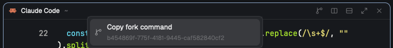

# Fork Session for Herdr

This [Herdr](https://herdr.dev) mod adds a fork button to every pane header.
Click it on a Claude Code or Codex pane, or right-click the header, and it
copies a command that forks that pane's session:

```sh
cd '/path/to/project' && claude --resume <session-id> --fork-session
cd '/path/to/project' && codex fork <thread-id>
```



## Install

Ask your agent:

> Add the Herdr mod at https://github.com/daniel7an/herdr-fork-session

The agent follows [RECIPE.md](RECIPE.md). It copies `mods/fork-session` and
`mods/fork-session-menu` into `~/.config/herdr-app/mods/` and points your
layout's pane header at `fork-session`.

To install it yourself:

1. Copy both folders in `mods/` into `~/.config/herdr-app/mods/`.
2. Set the pane header on the `{ "tab": "active" }` block of a layout you own.
   The shipped `main` layout can't be edited, so clone it first.
   ```json
   "pane": { "header": { "content": { "mod": "fork-session" }, "height": 30, "position": "top", "reveal": "always" } }
   ```
3. Run `herdr-app check ~/.config/herdr-app/mods/fork-session`.

## Notes

Claude Code sessions are matched exactly. Codex sessions are a best guess from
the folder and the terminal title, so check the ID in the toast before running
a Codex command.

It works on macOS and Linux, using `pbcopy`, `wl-copy`, `xclip` or `xsel`, and
in spaces on remote machines.

`fork-session` is based on the `pane` header that ships with Herdr 0.1.12, so it
won't pick up later Herdr changes to that header.

## License

Apache-2.0, like Herdr. `mods/fork-session` is a modified copy of Herdr's `pane`
mod.
