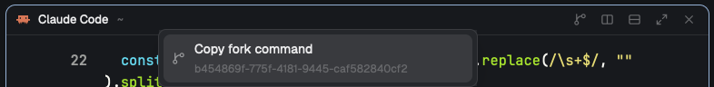

# Fork Session

Fork Session is a pane header for Herdr that forks the agent session running in
a pane. Hover over a Claude Code or Codex pane's header and click the branch
icon, or right-click the header and choose Copy fork command. Herdr copies a
command such as `cd '/path/to/project' && claude --resume <id> --fork-session`
and shows it in a toast. Paste it into any terminal to start a new session that
has the same conversation history.

## What you see

Each pane card has a 30px header at the top that looks like Herdr's shipped
`pane` header. From the left, it shows the program icon (14px), the agent or
program name (12px, medium weight, up to 260px wide) and the folder, dimmed
and shortened with `~`. The agent's status comes next: a spinning ring while it
works, a "Needs you" pill when it's blocked, and a 7px dot when it's done.

Hovering shows 14px icon buttons, dimmed until the pointer is on one. The first
is the fork button, a git-branch icon with the tooltip "Copy fork command". It
appears only on Claude Code and Codex panes. Split right, split down,
zoom/unzoom and close follow it.

Right-clicking opens a 320×58px popup at the pointer. Its one row has the
branch icon, "Copy fork command", and the session ID on a dimmed second line.
When there's no session to fork, that line gives the reason instead ("Not a
Claude Code or Codex pane", "Session not found" or "No agent running here")
and the whole row is dimmed.

A toast reports the result. "Fork command copied" is a success toast that
shows the command for 4 seconds. "Can't fork this pane" is a warning with the
reason, and "Couldn't copy fork command" is an error with the clipboard tool's
message.

## How it behaves

Clicking the header focuses the pane, as the shipped header does. The fork
button looks up the session and copies the command straight away.
Right-clicking does the same lookup first and then opens the popup, where a
click on the row or Enter copies the command and closes it. Esc or a click
elsewhere closes it without copying.

Working, blocked and done show as described above, and idle shows nothing. The
fork button appears in every status as long as the agent is Claude Code or
Codex.

In a space on another machine (`space.machine`), the lookup runs on that
machine. The command still goes to this computer's clipboard, so paste it into
a terminal on the other machine.

It copies `cd '<cwd>' && claude --resume <id> --fork-session` for Claude Code
and `cd '<cwd>' && codex fork <id>` for Codex. Launch flags like
`--dangerously-skip-permissions` or `--yolo` aren't carried over.

## Built from

`mods/fork-session/` is a clone of Herdr 0.1.12's shipped `pane` mod, made with
`mod.clone {name: "pane", as: "fork-session"}`, which rewrites its asset paths
to `mods/fork-session/`. It differs from the original in three places. The
header root has an `.on_mouse_down("right", …)` that stops propagation, runs the
lookup, and calls
`openOverlay({ mod: "fork-session-menu", kind: "popup", width: 320, height: 58, props: { result } })`.
A `forkButton` sits before the split button while the header is hovered and
`panes()` reports `app` as `"claude-code"` or `"codex"`. Its icon, `fork.svg`, is
a copy of `mods/workspace-chrome/git-branch.svg`. The header still uses Herdr's
`mods/workspace-chrome/spinner.svg`.

`mods/fork-session/fork.js` holds the lookup and the copy, imported as
`./fork.js`. A mod can't import files from another mod's folder, so the header
does the lookup and passes the result to the popup in its props.

1. `hc(["get", terminal, "--json"])` gives the terminal's `foreground` (`pid`,
   `argv`, `cwd`), `status.app` and `title`.
2. The machine is the `machine` of the space in `spaces()` that holds the
   pane's tab. Every lookup command runs with `exec(…, { on: machine })`.
3. For Claude Code (`status.app` is `claude-code`, or argv[0] is `claude`), a
   running interactive process writes `~/.claude/sessions/<pid>.json`, and its
   `sessionId` is the exact session.
4. For Codex (`codex`), the TUIs share one app-server, so no file links a
   process to its thread. The lookup reads the newest `~/.codex/state_*.sqlite`
   with
   `sqlite3 -json "select id, title, name, created_at from threads where cwd = <cwd> and archived = 0 order by updated_at desc limit 50"`.
   Codex titles its terminal `<thread title> | <folder>`, so the lookup prefers
   the thread whose `name` or `title` matches the terminal title up to its
   first ` | `, ignoring case. Failing that, it takes the newest thread created
   since the process started (`ps -o etime=`, with 5 seconds of slack). This is
   a best guess.
5. The copy runs `sh -c` with the first of `pbcopy`, `wl-copy`,
   `xclip -selection clipboard` or `xsel -b` that exists, feeding it the
   command on stdin. It always runs on this computer.

`mods/fork-session-menu/` is the popup. It shows `props().result` (`{ id, cmd }`
or `{ error }`) and copies with the same clipboard script. Its `mod.json` is
`{ "place": "none" }`.

To use it, point the pane header of a layout you own at the mod:
`"pane": { "header": { "content": { "mod": "fork-session" }, … } }`. Herdr's
shipped `main` layout has no pane header and can't be edited, so clone it first
(`layout.clone {name: "main", as: "my-layout"}`) and add the header to its
`{ "tab": "active" }` block.

It uses these Herdr functions: `panes`, `spaces`, `props`, `run`, `theme`,
`home`, `openOverlay`, `closeOverlay`, `exec`, `hc` and `notify`. It runs the
commands `pane.focus`, `pane.split`, `pane.zoom` and `pane.close`, and the
programs `sh`, `cat`, `ps`, `sqlite3` and a clipboard tool.

## Watch out

Write each folder's `mod.json` with `"place": "none"` before its `main.js`. The
first time Herdr sees a new mod folder, it docks the mod into the shown layout,
and without that setting the popup mod becomes a sidebar panel. If that
happens, remove its block from the layout.

The header is a clone of Herdr's `pane` mod, so later Herdr changes to the
shipped header won't reach it. To pick them up, clone `pane` again and redo the
changes listed under Built from.

Codex matching is a guess. With two Codex sessions in the same folder, check
the session ID in the popup or the toast before you run the command.

Claude Code writes `~/.claude/sessions/<pid>.json` only for running interactive
sessions, so `claude -p` runs and very old versions show "Session not found".

It runs only on macOS and Linux, because the lookup and copy go through `sh`.
Linux needs `wl-copy`, `xclip` or `xsel`. Headless servers usually have none,
which doesn't matter for a remote space because the copy happens on this
computer. Codex lookups need `sqlite3` on the machine where Codex runs.

The right-click popup waits for one lookup (about 50 to 150ms), and it opens
wherever the pointer is when the lookup finishes.

Don't keep a `cx` across callbacks. The `cx.spawn` tasks here only call module
functions and `openOverlay`.

## Done when

1. `herdr-app check ~/.config/herdr-app/mods/fork-session` and
   `herdr-app check ~/.config/herdr-app/mods/fork-session-menu` both pass, and
   `herdr-app status` shows no errors.
2. Hovering over a Claude Code pane's header shows the branch icon to the left
   of split right. Clicking it shows "Fork command copied", and the pasted text
   is `cd '<that pane's folder>' && claude --resume <id> --fork-session`, where
   `<id>` is the `sessionId` in `~/.claude/sessions/<the claude pid>.json`.
3. Running the pasted command opens Claude Code with that conversation's
   history under a new session ID.
4. Right-clicking the same header opens the popup with that session ID, and
   Enter copies the command and closes the popup.
5. A plain shell pane has no fork button, and right-clicking its header shows
   "Not a Claude Code or Codex pane" on a dimmed row.
6. A Codex pane copies `codex fork <id>`, and running it opens the same thread.
